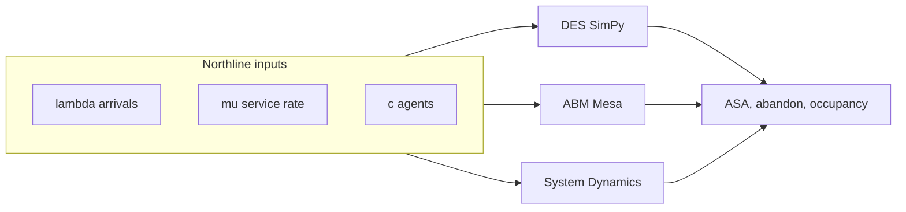

# Course Overview

You will model **Northline Support**, an imaginary customer service centre, using three simulation paradigms. The same operational story—calls arrive, agents answer, callers sometimes abandon—becomes a **discrete-event model (DES)**, an **agent-based model (ABM)**, and a **system dynamics (SD)** sketch. The goal is not to pick a “winner” but to recognise which lens answers which question.

## Three paradigms, one call centre

| Paradigm | Core metaphor | Best questions | Primary Python tool |
|----------|---------------|----------------|---------------------|
| **DES** | Event calendar | When does the queue spike? What is ASA under peak λ? | [SimPy](https://simpy.readthedocs.io/) |
| **ABM** | Individuals + rules | Who abandons? How do heterogeneous agents change SL? | [Mesa 2.x](https://mesa.readthedocs.io/) |
| **SD** | Stocks & flows | How does hiring lag create a months-long backlog loop? | NumPy + Euler (this course) |



Each paradigm reuses the **same symbol vocabulary** (λ, μ, c, patience, time step dt) so comparisons in Module 06 are fair.

## Course mechanics

| Component | What you do | How success is checked |
|-----------|-------------|-------------------------|
| **Theory** | Read concepts, run snippets locally | Self-check via quizzes |
| **Quizzes** | Multiple-choice in Streamlit / Flet | Immediate feedback |
| **Challenges** | Fill in Python stubs | `pytest` autograder |
| **Capstone** | Brief comparing three models | Rubric in Module 06 |

**Study path (recommended order)**

1. **01_get_started** — workflow, stack, conventions (this module).
2. **02_the_call_centre** — Northline scenario, queueing, KPIs, parameter mapping.
3. **03–05** — One paradigm per module: theory → quiz → challenge.
4. **06_comparing_paradigms** — Verification, validation, experiments.
5. **07_wrapping_up** — Portfolio checklist and reading list.

Skim theory before each challenge; the challenge docstring points at the matching theory filename.

## How pytest fits in

Challenges live under `*/challenges/*.py`. Tests live under `tests/<module>/`. Pytest is the course’s **verification harness**: it checks that your functions match agreed definitions (e.g. traffic intensity \(A = \lambda / (c \mu)\)), not that your simulation is “realistic.”

```python
# Typical local check (Module 02 example)
# pytest tests/02_the_call_centre/test_queueing_metrics.py -v

def traffic_intensity(arrival_rate: float, n_agents: int, service_rate: float) -> float:
  """Return offered load A = λ / (c · μ)."""
  return arrival_rate / (n_agents * service_rate)
```

| pytest role | Simulation role |
|-------------|-----------------|
| Unit tests on formulas | **Verification** — code matches spec |
| Fixed seeds in tests | Reproducible CI runs |
| Your DES/ABM runs | **Validation** — model vs reality or vs theory |

Use a dedicated virtual environment, install from `requirements.txt`, and run the full suite before opening a pull request:

```bash
pytest -q
```

## What “imaginary” Northline means

Numbers are **didactic** (e.g. λ = 10 calls/min, μ = 3 per agent, c = 4) but structures match real centres: FIFO queue, parallel agents, abandonment, occupancy targets. You are learning **methodology** transferable to production workforce management tools.

## Prerequisites

| Skill | Used for |
|-------|----------|
| Python functions & classes | Challenges, SimPy processes, Mesa agents |
| Basic probability | Exponential inter-arrivals, seeds |
| Reading traceback errors | Debugging event-driven code |

Prior pytest experience helps; Module challenges include `pass` stubs and failing tests that teach by example.

## Deliverables by the end

- Runnable **SimPy** call-centre DES with warm-up and replication discipline.
- **Mesa** model with caller patience and observable KPIs.
- **SD** backlog / staffing loop with documented dt choice.
- Short **comparison brief** stating when each lens misleads.

## Key takeaway

Treat the three paradigms as **complementary cameras** on Northline Support: DES for temporal detail at minute scale, ABM for behavioural heterogeneity, SD for slow workforce feedback. Pytest keeps your building blocks honest while you iterate on model credibility.
