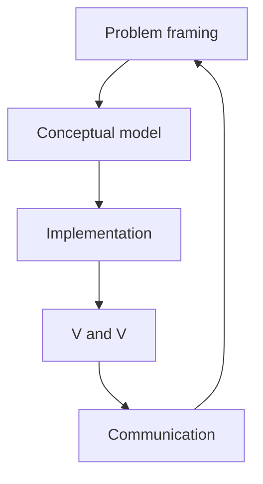

# The Simulation Workflow

Simulation projects fail more often from **unclear questions** than from wrong code. This course uses a single workflow—problem framing → conceptual model → implementation → verification & validation (V&V) → communication—so each Northline module stays aligned with a decision someone at operations could actually use.

## Workflow overview



| Phase | Question you must answer | Northline example |
|-------|--------------------------|-------------------|
| **Framing** | What decision? What scope? | “Do we need a 5th agent on the billing queue at 09:00?” |
| **Conceptual** | Entities, states, time advance | Calls, agents, queue; DES event clock |
| **Implementation** | Code, parameters, RNG | SimPy `Resource(capacity=c)` |
| **V&V** | Right code? Right model? | pytest + compare to M/M/c ASA formula |
| **Communication** | So what? | Table: ASA, abandon %, occupancy for scenarios |

## 1. Problem framing

Write a **one-paragraph charter** before opening an IDE.

| Element | Template |
|---------|----------|
| Decision | Approve / defer staffing change |
| Stakeholder | Queue manager |
| Horizon | One busy day (DES) vs one quarter (SD) |
| KPIs | ASA, % answered within 30s, abandon rate |
| Out of scope | Network routing, CRM integration |

**Bad framing:** “Simulate Northline.”  
**Good framing:** “Estimate ASA and abandon rate for λ = 12 between 08:00–10:00 with c = 4 vs c = 5, holding μ fixed.”

## 2. Conceptual model

Pick a **paradigm** (see Module 02 `03_choosing_a_lens.md`). Sketch:

- **Entities:** callers, agents (DES: processes; ABM: agents on a grid is optional—here we use collections).
- **State variables:** queue length, agents busy, cumulative abandons.
- **Dynamics:** arrival process, service completion, abandonment rule.
- **Outputs:** time series + summary statistics.

Keep the conceptual model **parity-free**: no Python yet, but name parameters λ, μ, c explicitly.

## 3. Implementation

Translate sketch to code with **traceability**:

| Conceptual item | DES (SimPy) |
|-----------------|-------------|
| Waiting line | `simpy.Resource` or `PriorityResource` |
| Call arrival | `env.process(arrivals())` |
| Service time | `yield env.timeout(rng.expovariate(mu))` |

```python
# Traceability comment pattern (Northline DES stub)
# CONCEPT: exponential inter-arrival, mean 1/lambda_minutes
INTER_ARRIVAL_MEAN = 1.0 / 10.0  # lambda = 10 per minute
```

Use **pydantic** or typed functions at boundaries (`CallCentreSnapshot` in `shared/models.py`) so challenges and simulations share shapes.

## 4. Verification & validation (V&V)

| Term | Meaning | Course activity |
|------|---------|-----------------|
| **Verification** | Building the model right | pytest on formulas; stepping debugger on events |
| **Validation** | Building the right model | Compare DES ASA to Erlang C approximation; face validity with SMEs |

**Checklist before trusting output**

- [ ] Units consistent (calls per **minute** vs per hour)
- [ ] Stability: \(A = \lambda/(c\mu) < 1\)
- [ ] Warm-up discarded for time-dependent stats (Module 03)
- [ ] Multiple replications with different seeds
- [ ] Extreme scenarios sanity-checked (λ → 0, c → large)

```python
def check_stability(lam: float, c: int, mu: float) -> None:
    a = lam / (c * mu)
    if a >= 1.0:
        raise ValueError(f"Northline unstable: A={a:.2f} >= 1")
```

## 5. Communication

Deliverables are **tables and one chart**, not raw event logs.

| Scenario | c | ASA (s) | Abandon % | SL30 % |
|----------|---|---------|-----------|--------|
| Baseline | 4 | … | … | … |
| +1 agent | 5 | … | … | … |

State **assumptions** (Poisson arrivals, exponential service, infinite patience unless noted) and **uncertainty** (95% CI across replications if you have them).

## End-to-end checklist (printable)

| Step | Done when |
|------|-----------|
| Charter signed (even if “signed” = you agree with yourself) | KPIs and horizon written |
| Paradigm chosen with rationale | One paragraph |
| Parameters sourced | Table with λ, μ, c, patience |
| Code + seeds | `random.Random(seed)` per replication |
| Verification | pytest green |
| Validation | At least one external anchor (formula or historical day) |
| Communication | Scenario comparison table |

## Key takeaway

Simulation is **structured judgment**. Northline Support stays manageable when you force each paradigm through the same five phases; pytest accelerates verification, but validation still requires you to compare outputs against theory, data, or expert expectation.
