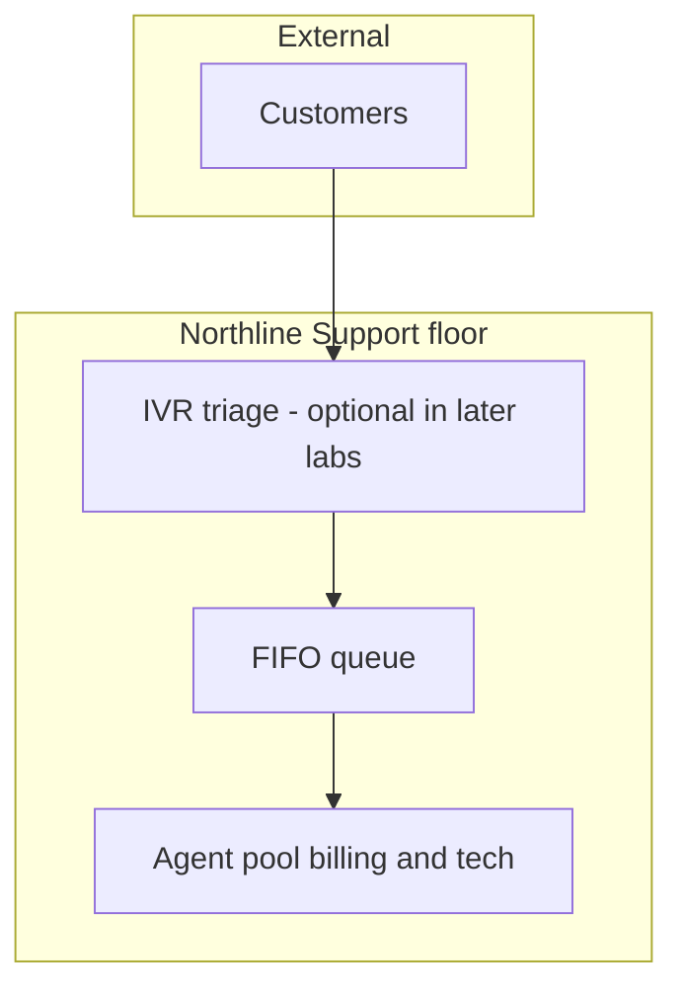

# Meet Northline Support

**Northline Support** is a mid-sized inbound contact centre for a regional utilities brand. Customers call about **billing**, **outages**, and **self-service account access**. Operations leadership cares about customer wait experience, agent utilisation, and whether marketing campaigns overload the morning queue.

This module defines the **shared scenario** every later paradigm inherits. Numbers are round for mental arithmetic; the **structure** matches industry queueing models.

## Organisation (simplified)



| Role | Count (baseline day) | Notes |
|------|----------------------|-------|
| Frontline agents | **c = 4** | Homogeneous skill in baseline DES |
| Team lead | 1 | Not modelled as a server |
| Workforce planner | 1 | Consumes your KPI tables |

**Call types (baseline mix)**

| Type | Share of volume | Typical handle time |
|------|-----------------|---------------------|
| Billing | 55% | Shorter; drives λ spikes after bill drops |
| Outage / emergency | 15% | Priority in advanced labs only |
| Account access | 30% | Password resets; medium duration |

For λ and μ we use **blended averages** unless a challenge splits types.

## Baseline scenario (busy hour)

These parameters appear in theory, quizzes, and challenges:

| Symbol | Meaning | Baseline value |
|--------|---------|----------------|
| λ | Arrival rate | **10** calls / minute |
| μ | Service rate per agent (while busy) | **3** calls / minute |
| c | Agents logged in | **4** |
| Patience | Max wait before abandon | **3** minutes (ABM / extended DES) |
| Hours simulated | Single peak slice | 60 minutes |

**Traffic intensity** (offered load in Erlangs):

\[
A = \frac{\lambda}{c \mu} = \frac{10}{4 \times 3} \approx 0.83
\]

The system is **stable** (\(A < 1\)): agents can theoretically keep up on average, yet randomness still creates queues and abandons.

```python
# Baseline sanity print (no simulation yet)
LAMBDA = 10.0
MU = 3.0
C = 4

A = LAMBDA / (C * MU)
print(f"Northline busy-hour offered load A = {A:.2f}")  # 0.83
```

## Service level targets (what leadership quotes)

| Metric | Target | Measurement window |
|--------|--------|--------------------|
| Service level (SL30) | **80%** answered within **30 seconds** | Rolling 30 min |
| ASA | ≤ **45 seconds** | Same window |
| Abandon rate | ≤ **5%** | Daily |
| Occupancy | **82–88%** | Not too low (waste) or too high (burnout) |

Your models will **estimate** these from simulated wait and disposition data, not from Erlang spreadsheets alone.

## Call flow narrative (baseline DES story)

1. Call arrives according to a **stochastic** arrival process (often Poisson → exponential inter-arrivals).
2. Call enters **FIFO** queue if all agents busy.
3. Agent answers; service duration is random with mean \(1/\mu\).
4. (ABM) Caller may **abandon** if wait exceeds patience.
5. KPIs accumulate: answered, abandoned, wait times.

## What we deliberately simplify

| Real-world detail | Course treatment |
|-------------------|------------------|
| Shifts, breaks, ACW | Fixed c during hour |
| Skill-based routing | Single μ |
| Callbacks | Ignored in Module 02–03 |
| Seasonality | Single λ plateau |

Simplification is a **modelling choice**; document it in your comparison brief (Module 06).

## Data you might “calibrate” in a real project

| Source | Maps to |
|--------|---------|
| ACD reports | λ by interval, ASA, abandons |
| Erlang tools | Sanity-check DES |
| HR roster | c(t) for SD |

Northline uses **published baseline numbers** so every learner’s pytest and plots align.

## Python: snapshot type

Challenges use a pydantic snapshot for nominal state:

```python
from shared.models import CallCentreSnapshot

snapshot = CallCentreSnapshot(
    backlog=2.0,
    staffed_agents=4.0,
    answered_today=87.0,
)
```

`backlog` is a **continuous proxy** in SD; in DES it would be an integer queue length at an instant.

## Key takeaway

Northline Support is the **shared cast**: λ, μ, c, and SL targets recur in SimPy, Mesa, and SD code. Memorise the baseline hour (\(A \approx 0.83\)) so when ASA spikes in a challenge, you can tell randomness from instability or a parameter typo.
