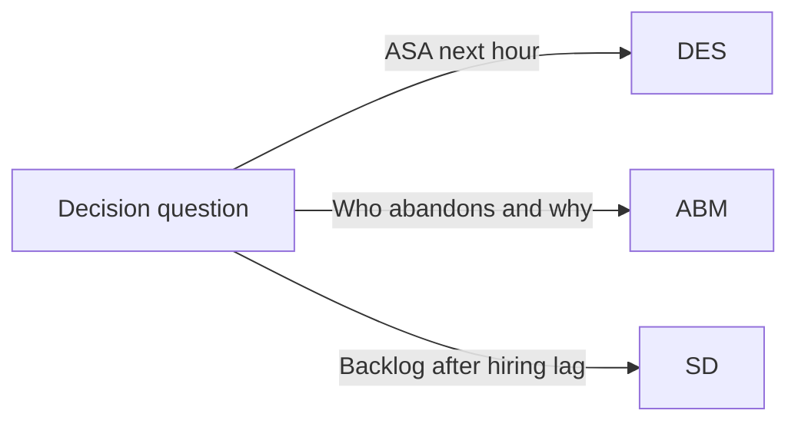

# Choosing a Simulation Lens

Northline Support can be modelled as events, agents, or aggregate stocks. The **wrong question** is “Which paradigm is true?” The **right question** is “Which abstraction fits the decision horizon and the behaviours we care about?”

## Decision table: DES vs ABM vs SD

| Criterion | Prefer **DES** | Prefer **ABM** | Prefer **SD** |
|-----------|----------------|----------------|---------------|
| Time focus | Minutes to days | Minutes to days (rule-rich) | Weeks to years |
| Granularity | Individual call **events** | Individual **entities + rules** | **Aggregate** flows |
| Abandonment / patience | Can add, but often queue-centric | Natural fit (per-caller state) | Usually need auxiliary stocks |
| Heterogeneous agents | Possible via multiple resources | **Strength** | Limited |
| Workforce hiring loop | Awkward (many HR rules) | Possible but heavy | **Strength** |
| Real-time staffing | **Excellent** | Good | Too coarse |
| Computational cost | Moderate | Higher headcount | Low dimension |



## Horizons and stakeholders

| Horizon | Example question | Lens |
|---------|------------------|------|
| **Operational** (0–48 h) | Add one agent at 09:00? | DES |
| **Tactical** (weeks) | Campaign + patience mix change? | DES or ABM |
| **Strategic** (months) | Hire 10 FTE vs overtime policy? | SD |

Operations managers often want **DES** charts; HR / finance planners want **SD** loops. ABM bridges when **individual differences** change KPIs materially (e.g. 20% impatient segment).

## Northline scenarios mapped

| Scenario | Recommended lens | Why |
|----------|------------------|-----|
| Peak λ = 14 for one hour, c fixed | DES | Exact event order for waits |
| 30% callers with 1-min patience | ABM | State per caller |
| Attrition ↑ when occupancy > 90% for months | SD | Feedback + slow stocks |
| Verify Erlang C ASA | DES (+ formula) | Cross-check |
| Compare paradigms capstone | All three | Same KPIs, different stories |

## When spreadsheets masquerade as simulation

| Spreadsheet habit | Simulation upgrade |
|-------------------|---------------------|
| Single average λ | Time-varying arrival process |
| No queue variability | Stochastic waits |
| Instant staffing changes | Lead times in SD |

If the model never **samples** waiting time, it is not answering Northline’s SL30 question credibly.

## Pairing paradigms (preview Module 06)

| Pattern | Use |
|---------|-----|
| SD → DES | SD sets c(t); DES tests intraday ASA |
| DES → ABM | DES finds congestion windows; ABM adds behaviour |
| DES validates SD | Compare average backlog |

Avoid **double counting**: do not embed full DES inside every SD Euler step without a clear time-scale separation.

## Python: same parameters, three entry points

```python
# Shared Northline parameters (conceptual)
PARAMS = {
    "lambda_per_min": 10.0,
    "mu_per_min": 3.0,
    "c_agents": 4,
    "patience_min": 3.0,   # ABM / extended DES
    "dt_days": 0.25,       # SD only — 6 hours
}
```

| Parameter | DES | ABM | SD |
|-----------|-----|-----|-----|
| `lambda_per_min` | Inter-arrival rate | Spawn rate per tick | Inflow to backlog |
| `mu_per_min` | Service timeout rate | Handling rate rule | Outflow capacity |
| `c_agents` | `Resource(capacity=c)` | Count of agent agents | Stock or capacity |
| `patience_min` | Timeout on wait | Caller attribute | Optional flow |
| `dt_days` | N/A | Tick size | Integration step |

## Red flags by lens

| Lens | Model may mislead when… |
|------|-------------------------|
| DES | Run too short; no warm-up; λ non-stationary hidden |
| ABM | Rule soup; untested micro-calibration |
| SD | dt too large; missing delays; instant staffing |

## Key takeaway

Pick the lens from **decision horizon and behaviour**, not from tool fashion. Northline’s hourly ASA points to DES; heterogeneous patience points to ABM; hiring and attrition loops point to SD. Later modules implement each; Module 06 forces you to defend the choice in writing.
