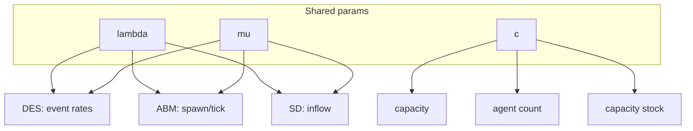

# Mapping Parameters Across Paradigms

Northline uses one **parameter vocabulary**—λ, μ, c, patience, dt—so DES, ABM, and SD stay comparable. This lesson is the **rosetta stone**: the same symbol may mean an event rate, a per-tick probability, or a continuous flow depending on the lens.

## Master mapping table

| Symbol | Meaning | Units (course) | DES (SimPy) | ABM (Mesa) | SD (Euler) |
|--------|---------|----------------|-------------|------------|------------|
| **λ** | Call arrival intensity | calls / minute | `expovariate(λ)` inter-arrival | Spawns per tick: `λ * dt_tick` | Inflow to backlog stock |
| **μ** | Service completion rate (per busy agent) | calls / minute | `expovariate(μ)` service timeout | Handle prob. / duration rule | Max outflow per agent |
| **c** | Parallel servers | count | `Resource(capacity=c)` | Number of agent agents | Capacity / staffing stock |
| **patience** | Max wait before abandon | minutes | Optional wait timeout | Caller attribute decremented | Abandon outflow (if modelled) |
| **dt** | Time step | minutes or days | *Not used* (event time) | Model `step()` delta | Euler integration step |



## Unit consistency checklist

| Pitfall | Fix |
|---------|-----|
| λ per **hour** in spreadsheet, per **minute** in code | Convert explicitly |
| μ confused with mean service **time** | μ is rate; mean time = 1/μ |
| dt in days while λ per minute | Convert to common time base |

```python
def lambda_per_min_from_hourly(lam_hour: float) -> float:
    return lam_hour / 60.0

def mean_service_min(mu_per_min: float) -> float:
    return 1.0 / mu_per_min
```

Northline baseline: λ = 10/min, μ = 3/min → mean service ≈ **0.333 min** (20 seconds) per call **while in service** (blended average).

## DES implementation sketch

| Parameter | SimPy expression |
|-----------|------------------|
| λ | `yield env.timeout(rng.expovariate(lam))` between arrivals |
| μ | `yield env.timeout(rng.expovariate(mu))` during service |
| c | `agents = simpy.Resource(env, capacity=c)` |
| patience | Extra `timeout` on wait path (extended lab) |

Clock is **continuous**; no dt.

## ABM implementation sketch

Time advances in **ticks** of size `dt_tick` (minutes).

| Parameter | Mesa rule (example) |
|-----------|---------------------|
| λ | Expected arrivals this tick: Poisson with mean `λ * dt_tick` |
| μ | If matched, decrement remaining service by `dt_tick` |
| c | At most c concurrent services |
| patience | `waited += dt_tick`; abandon if `waited > patience` |

```python
DT_TICK = 0.1  # minutes — 6 seconds; must be documented
expected_arrivals = LAMBDA * DT_TICK
```

Smaller `dt_tick` → closer to DES timing, higher compute cost.

## SD implementation sketch

Stocks might include **backlog** B and **staff** S (agents). Flows use **dt** in **days** for strategic modules.

| Parameter | SD flow (stylised) |
|-----------|-------------------|
| λ | `arrivals = lambda_per_day * dt_days` |
| μ, c | `capacity = c * mu_per_day * dt_days` handled calls removed from B |
| patience | Optional nonlinear abandon flow when B/S large |

Convert rates:

```python
LAMBDA_PER_MIN = 10.0
MINUTES_PER_DAY = 24 * 60
LAMBDA_PER_DAY = LAMBDA_PER_MIN * MINUTES_PER_DAY
```

## Traffic intensity (unchanged across lenses)

\[
A = \frac{\lambda}{c \mu}
\]

Compute on a **common time unit** for λ and μ. Stability rule \(A < 1\) applies to the **queueing interpretation**; SD may show temporary backlog growth from **flows** even when long-run averages are stable—read Module 05 limits.

## Challenge alignment

| File | Uses mapping for |
|------|------------------|
| `queueing_metrics.py` | A, stability, snapshot |
| `call_centre_des.py` | λ, μ, c in SimPy |
| Later ABM / SD challenges | patience, dt |

## Key takeaway

**Parameters are contracts** between paradigms. Before comparing ASA from SimPy, Mesa, and SD, confirm λ and μ share units, c means the same capacity, and dt exists only where time is stepped. Northline stays one organisation because the mapping table stays one source of truth.
