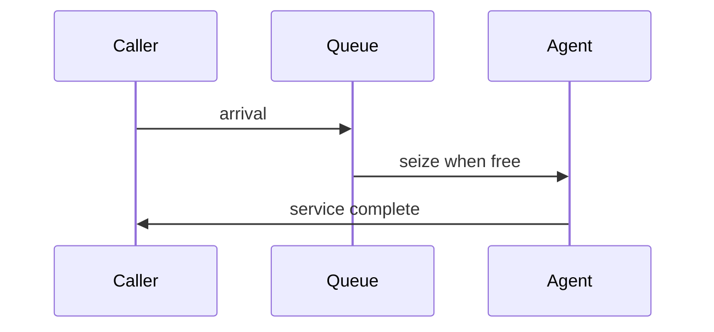

# Why DES for Call Centres

**Discrete-event simulation (DES)** advances time from **event to event**—call arrives, agent frees, caller abandons—instead of chopping the day into fixed slices. For Northline Support, that matches how workforce tools reason about **peaks, concurrency, and wait-time percentiles**.

## What DES is good at

| Capability | Northline payoff |
|------------|------------------|
| **Ordering** | Who waits when all agents are busy |
| **Resource contention** | Exactly c parallel servers |
| **Time-varying λ(t)** | Morning ramp without changing paradigm |
| **KPIs from timestamps** | SL30 from wait-at-answer samples |



## DES vs fixed time-step

| Approach | When time moves | Typical call-centre fit |
|----------|-----------------|-------------------------|
| **DES** | Next scheduled event | Strong — sparse events over empty time |
| Fixed Δt (Euler/ABM tick) | Every step | OK for rules; may waste work |

SimPy’s `Environment` jumps the clock to the **minimum** next event time—efficient for sparse call arrivals.

## Where DES is weaker

| Gap | Mitigation |
|-----|------------|
| Months-long HR feedback | Pair with SD |
| Rich cognitive caller behaviour | ABM rules on entities |
| Algebraic SL if assumptions match M/M/c exactly | Use formulas as validation anchor |

DES does not replace Erlang calculators; it **extends** them when assumptions break (abandonment, staffing changes mid-day).

## Northline questions that scream DES

1. **What is ASA** if marketing lifts λ from 10 to 14 for 45 minutes with c = 4?
2. **How often** does the queue exceed 10 calls?
3. **What happens** if one agent logs off at minute 20?

Each needs **event-level** concurrency, not monthly average flows alone.

## Minimal DES mental model

| Object | Role |
|--------|------|
| **Entities** | Calls (processes) |
| **Resources** | Agent pool, capacity c |
| **Events** | Arrival, start service, end service, abandon |
| **Clock** | Simulation time in minutes |

State is **implicit** in who is waiting and who holds the resource.

## Python tease (full pattern in next lessons)

```python
import random
import simpy

def simulate_busy_hour(seed: int = 42):
    rng = random.Random(seed)
    env = simpy.Environment()
    agents = simpy.Resource(env, capacity=4)
    waits: list[float] = []

    # env.process(arrival_driver(env, agents, rng, waits))
    # env.run(until=60.0)
    return waits
```

Your Module 03 challenge fills in metrics collection and run discipline.

## DES in the course workflow

| Phase | DES activity |
|-------|--------------|
| Framing | Hourly KPI targets |
| Conceptual | Event list narrative |
| Implementation | SimPy processes |
| Verification | pytest + event count |
| Validation | Compare to M/M/c baseline |
| Communication | ASA / SL30 table |

## When to choose something else

| Signal | Consider ABM or SD |
|--------|---------------------|
| KPI depends on **segment mix** patience | ABM |
| Decision is **hiring over quarters** | SD |
| Need **scriptable** real-time replay API | DES still wins |

## Key takeaway

Choose DES for Northline when the decision lives on the **event timeline**: queues, waits, and occupancy under random arrivals. SimPy makes that timeline executable; later lessons add resources, run length, and validation against queueing theory.
