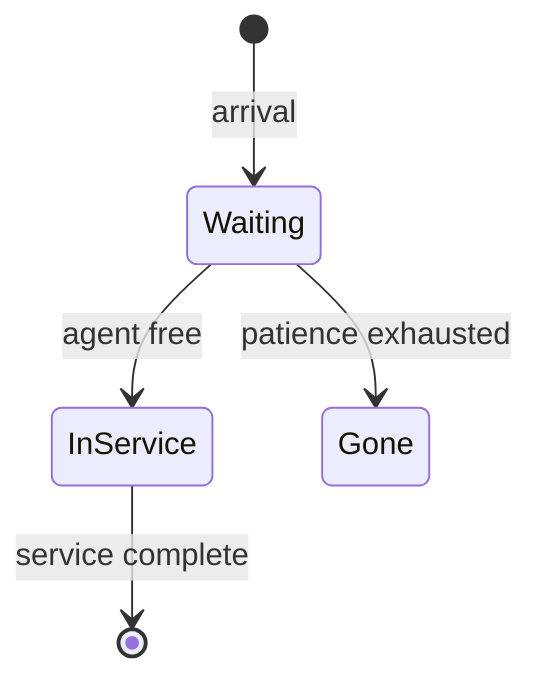

# DES Concepts & Event Calendar

Discrete-event simulation models Northline Support as a **state** that changes only at **instants** when events occur. Between events, nothing happens—the clock jumps. Mastering entities, attributes, events, the **event list**, and the **simulation clock** keeps your SimPy code traceable to operations language.

## Core vocabulary

| Term | Definition | Northline example |
|------|------------|-------------------|
| **Entity** | Thing that flows through the system | Inbound call |
| **Attribute** | Data on an entity | `arrival_time`, `call_type` |
| **Resource** | Capacity-limited server | Agent pool, c = 4 |
| **Queue** | Waiting entities | FIFO line |
| **Event** | Instantaneous state change | Call answered |
| **State variable** | System snapshot | Queue length = 7 |
| **Clock** | Simulation time | `env.now` minutes |

Entities may be **passive** (records in a list) or **active** (SimPy processes). This course uses **processes** for each call or a generator for arrivals.

## Event types at Northline

| Event | Typical effect |
|-------|----------------|
| **Call arrival** | Increment queue; maybe start service |
| **Service start** | Decrement queue; mark agent busy |
| **Service end** | Release agent; maybe pull next call |
| **Abandon** | Remove caller; update abandon KPI |



## Event list (future event set)

DES maintains pending events sorted by **time**. The engine repeatedly:

1. Remove **next** event (smallest time).
2. Advance **clock** to that time.
3. Execute event logic (may schedule new events).

SimPy hides the list in `Environment._queue`, but you still reason about **causality**: an arrival at t = 10.5 cannot be caused by a service end at t = 11.0.

| Hand-rolled DES | SimPy |
|-----------------|-------|
| Push `(t, handler)` on list | `yield env.timeout(Δ)` schedules resume |
| Pop min time | Built-in |

## Simulation clock

- **Clock** = scalar `env.now`, never wall clock.
- **Delay** = service or inter-arrival duration, not “sleep” on your laptop.

```python
import simpy

env = simpy.Environment()
print(env.now)  # 0.0 until env.run()

def demo():
    yield env.timeout(5.5)
    print(f"Clock at {env.now}")  # 5.5

env.process(demo())
env.run()
```

## Attributes vs global state

| Style | When to use |
|-------|-------------|
| Attributes on entity process | Per-call wait, type |
| Global `Metrics` object | Aggregated ASA, counts |

```python
class CallContext:
    def __init__(self, arrival: float):
        self.arrival = arrival
        self.wait: float | None = None
```

Avoid scattered globals; pass a `metrics` or `context` object into processes.

## FIFO discipline

Northline baseline: **first-in-first-out** queue behind `simpy.Resource`. Ties on release are handled by SimPy’s internal queue order—document if you add priority (billing vs outage).

## Time advance diagram

```mermaid
gantt
    title Northline DES clock (conceptual)
    dateFormat X
    axisFormat %s
    section Events
    Arrival A :0, 1
    Arrival B :3, 1
    B starts service :5, 8
    A starts service :8, 6
```



Real runs have many overlapping events; the **clock** only visits times where something happens.

## Common beginner mistakes

| Mistake | Symptom |
|---------|---------|
| Using wall `time.sleep` | DES not faster than real time |
| Forgetting to `yield` | Processes never run |
| Scheduling before seizing resource | Negative wait, wrong ASA |
| Mixing minutes and seconds | SL30 off by 60× |

## Traceability exercise

Write a **paper event list** for two agents and three calls before coding. Columns: time, event type, queue length, agents busy.

| Time | Event | Q | Busy |
|------|-------|---|------|
| 0.0 | A arrives | 0 | 0→1 start |
| … | … | … | … |

Match SimPy output in a debugger at those timestamps during verification.

## Key takeaway

DES clarity comes from the **event calendar**: entities carry attributes, resources constrain service, and the clock jumps between events. Northline’s queues are intelligible when you can narrate the next event from the current state without reading every line of Python.
