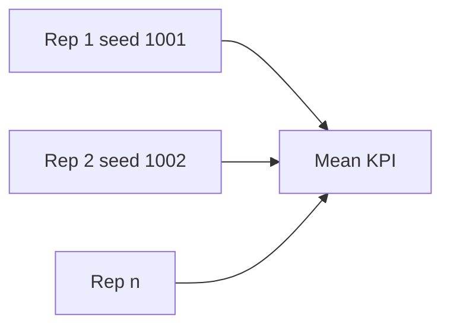

# Statistics, Warm-up & Run Length

A single 60-minute Northline DES replication is one **sample path** of a stochastic system. Workforce reports need **means**, sometimes **confidence intervals**, and honest handling of **transient** startup bias. This lesson covers warm-up, run length, batch means, and replications—the statistical layer on top of SimPy.

## Why one run is not enough

| Single run | Across replications |
|------------|---------------------|
| One queue trajectory | Distribution of ASA |
| Luck of burst arrivals | Central tendency + spread |
| May include startup bias | Each rep can discard warm-up |

```python
asa_per_rep = []
for rep in range(50):
    m = run_once(seed=1000 + rep, horizon_min=75.0)  # includes warm-up
    asa_per_rep.append(asa_after_warmup(m, warm_min=15.0))
mean_asa = sum(asa_per_rep) / len(asa_per_rep)
```

## Initial transient (warm-up)

At t = 0, Northline often starts **empty**: no queue, all agents idle. Early minutes are **not** representative of steady busy-hour congestion.

| Policy | Rule of thumb (teaching) |
|--------|--------------------------|
| Discard first W minutes | W = 15 for 60-min productive window |
| Start at historical snapshot | Skip warm-up if initial Q matches shift handover |

```python
def asa_after_warmup(metrics, warm_min: float) -> float:
    """Use only waits from calls arriving at env.now >= warm_min."""
    waits = [w for t, w in metrics.wait_records if t >= warm_min]
    return sum(waits) / len(waits) if waits else 0.0
```

**Never** include warm-up waits in SL30 reported to “leadership”—label clearly in tables.

## Run length

| Horizon | Use |
|---------|-----|
| Too short | High variance SL30; few abandons |
| 60 min productive | Matches one peak slice |
| 8 h | Shift studies (later projects) |

**Rule:** ensure enough **completed** calls post warm-up for stable ASA—often hundreds for λ = 10/min over 60 min (≈ 600 offered if stationary).

| Offered calls (approx) | λ × productive minutes |
|--------------------------|------------------------|
| 10 × 45 | 450 after 15 min warm in 60 min run |

Abandon rates need rarer events → may require **longer** runs or more reps.

## Replications vs batch means

Two strategies for output analysis:

### Independent replications (preferred in course)

| Step | Detail |
|------|--------|
| Fix scenario parameters | λ, μ, c |
| Change seed each rep | `base + rep` |
| One warm-up per rep | Fresh empty system |

### Batch means within one long run

Split one long simulation into **batches** separated by idle resets or regenerative points. Useful in research; harder in call centres without clear cycles. Course capstone emphasizes **replications**.

## Confidence intervals (simple)

If reps are independent, approximate 95% CI for mean ASA:

\[
\bar{x} \pm t_{0.975,\, n-1} \cdot \frac{s}{\sqrt{n}}
\]

```python
import statistics

def ci95_mean(values: list[float]) -> tuple[float, float]:
    n = len(values)
    if n < 2:
        m = values[0] if values else 0.0
        return m, m
    m = statistics.mean(values)
    s = statistics.stdev(values)
    half = 1.96 * s / (n ** 0.5)  # use t for small n in practice
    return m - half, m + half
```

Report: **ASA = 42 s (95% CI: 38–46)** across 50 reps.

## Autocorrelation warning

Successive minutes inside **one** run are **correlated**—do not treat every minute’s queue length as independent samples. That is why independent replications beat slicing one run into 60 “samples” without care.



## Pytest and short runs

Tests use **few events** and **fixed seeds**—not production run lengths. Your local tuning should scale up after pytest passes.

| Context | Horizon |
|---------|---------|
| pytest smoke | < 1 min sim time |
| Lab report | 60 + warm-up |

## Reporting checklist

| Field | Included? |
|-------|-----------|
| Warm-up duration | Yes |
| Productive horizon | Yes |
| Replications | Yes |
| KPIs computed on | Post warm-up only |
| Seeds | Yes |

## Key takeaway

Credible Northline DES results separate **transient** startup from **stationary** busy-hour behaviour, run long enough for stable KPIs, and aggregate **independent replications** with clear seeding. Statistics do not replace validation—they quantify how much one lucky arrival stream might have fooled you.
