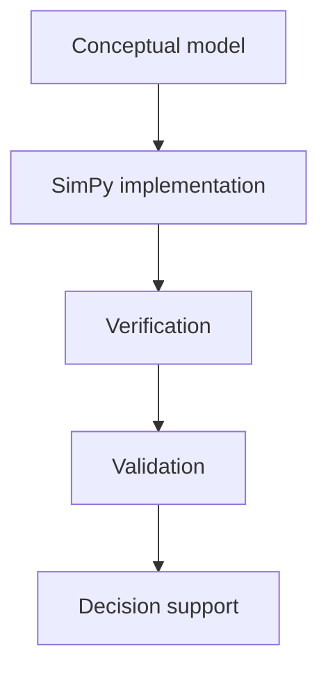

# DES Validation Checklist

**Verification** asks whether the SimPy model matches your written assumptions and passes pytest. **Validation** asks whether those assumptions are credible for Northline Support. Use this checklist before presenting ASA or abandon results to stakeholders.

## Verification vs validation

| | Verification | Validation |
|---|--------------|------------|
| Question | Did I implement the conceptual model? | Is the conceptual model useful? |
| Tools | pytest, code review, debug traces | Erlang M/M/c, SME review, ACD data |
| Failure example | Wait recorded at wrong event | λ from last year’s marketing week |



## Pre-run parameter checks

- [ ] Units: λ and μ in **calls per minute**
- [ ] Stability: \(A = \lambda/(c\mu) < 1\) for baseline scenarios
- [ ] `Resource(capacity=c)` matches roster assumption
- [ ] Seed logged per replication
- [ ] Horizon + warm-up documented

```python
def validate_params(lam: float, c: int, mu: float) -> None:
    assert lam > 0 and mu > 0 and c > 0
    a = lam / (c * mu)
    if a >= 1.0:
        raise ValueError(f"Unstable Northline DES: A={a:.3f}")
```

## Structural verification

| Check | How |
|-------|-----|
| FIFO discipline | Trace two calls competing for one agent |
| Conservation of callers | offered = served + abandoned + in queue at end |
| No negative waits | All `wait >= 0` |
| Agent capacity | At most c concurrent services |

```python
def conservation(offered: int, served: int, abandoned: int, in_queue: int) -> bool:
    return offered == served + abandoned + in_queue
```

## Event logic tests

- [ ] Arrival without seize never increments served
- [ ] Service ends release resource (context manager)
- [ ] Simulation stop policy for calls in progress defined
- [ ] Patience path cannot answer after abandon (extended)

Use short SimPy runs with **deterministic** times in unit tests (bypass expovariate) when debugging ordering bugs.

## Face validity (Northline)

| Output | Plausible? |
|--------|------------|
| ASA at A ≈ 0.83 | Seconds–low minutes, not hours |
| Occupancy | Not 5% during billed “busy hour” |
| Max queue | Spikes possible; sustained 500 unlikely |
| Abandon rate | Rises when ASA rises (if patience on) |

Ask: “Would a team lead laugh at this number?”

## Comparison validation (quantitative)

| Anchor | When applicable |
|--------|-----------------|
| M/M/c Erlang wait | No abandon; stationary λ, μ |
| Module 02 `traffic_intensity` | Always |
| Historical ACD day | If data provided in capstone |

| Agreement target (teaching) | Note |
|-----------------------------|------|
| ASA within few % of Erlang | Enough reps + warm-up |
| Directional +1 agent effect | ASA decreases |

## Statistical credibility

- [ ] Warm-up excluded from KPIs
- [ ] ≥ 30 replications for reported means (guideline)
- [ ] CI or spread shown, not single seed
- [ ] Common random numbers when comparing scenarios

## Implementation pitfalls table

| Symptom | Likely bug |
|---------|------------|
| ASA ≈ 0 always | Wait measured after service |
| Exploding queue at A < 1 | Wrong μ (hourly vs minute) |
| Identical reps | Forgot to change seed |
| pytest passes, DES wild | Test uses tiny horizon only |

## Documentation for auditors

| Section | Content |
|---------|---------|
| Assumptions | M/M, FIFO, infinite queue |
| Scope | One hour, fixed c |
| Known limits | No callbacks |
| Evidence | Table: DES vs Erlang ASA |

## Sign-off template

```text
Northline DES scenario: λ=10, μ=3, c=4, 60 min after 15 warm-up, 50 reps
Verification: pytest green; conservation holds; no negative waits
Validation: ASA within X% of Erlang; face valid vs SL30
Approved for: staffing what-if memo (not hiring plan)
```

## Key takeaway

A green pytest badge is only **verification**. Complete the full checklist—parameters, conservation, anchors, and replication discipline—so Northline DES results defendable in a comparison brief, not just pretty charts from one seed.
