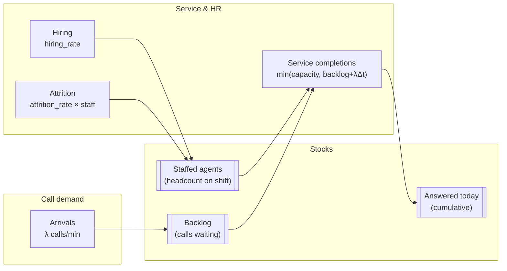

# Northline Stock–Flow Diagram

This lesson reads a **stock–flow diagram** for **Northline Support**—the same structure your Module 05 code integrates with Euler steps.

## Purpose of the diagram

A stock–flow diagram shows:

- **What accumulates** (stocks)
- **What changes it** (flows)
- **What depends on what** (feedback paths)

It is not a DES event chart or an ABM class diagram; time is **continuous in principle**, **discrete in code**.

## Core Northline diagram (Mermaid)



**Reading guide:**

- `ARR` raises **backlog** each interval.
- **Service completions** drain backlog but cannot exceed agent capacity.
- **Staffed agents** rise with hiring and fall with attrition.
- Capacity for service is **anchored to** the staffing stock.

## ASCII equivalent (slide-friendly)

```
     λ (arrivals)                hiring_rate
          │                            │
          ▼                            ▼
    ┌──────────┐   served flow    ┌────────────┐
    │ Backlog  │ ───────────────► │ Answered   │
    │ (calls)  │                  │ today      │
    └──────────┘                  └────────────┘
          ▲
          │ capacity ∝ staffed_agents × μ_agent
          │
    ┌────────────┐
    │ Staffed    │
    │ agents     │ ─── attrition_rate × staff ──► (out)
    └────────────┘
```

## Mapping diagram → `sd_euler_step`

| Diagram element | Code fragment |
|-----------------|---------------|
| Arrivals | `arrivals = params["arrival_rate"] * dt` |
| Service | `served = min(backlog + arrivals, service_capacity)` |
| Backlog update | `new_backlog = max(0, backlog + arrivals - served)` |
| Hiring | `hiring = params.get("hiring_rate", 0) * dt` |
| Attrition | `attrition = params.get("attrition_rate", 0) * staffed * dt` |
| Staff update | `new_staffed = max(0, staffed + hiring - attrition)` |

```python
def sd_euler_step(state: dict[str, float], params: dict[str, float], dt: float) -> dict[str, float]:
  backlog = state["backlog"]
  staffed = state["staffed_agents"]
  arrivals = params["arrival_rate"] * dt
  service_capacity = staffed * params["service_rate_per_agent"] * dt
  served = min(backlog + arrivals, service_capacity)
  ...
```

## Deliberate simplifications

The diagram **does not** include:

| Omitted | Real-world counterpart | Extension idea |
|---------|------------------------|------------------|
| In-service stock | Calls on phones | Add `in_service` stock |
| Abandonment flow | Impatient hang-ups | Couple to backlog or wait aux |
| Training pipeline | Weeks to proficiency | Chain of staffing stocks |
| Shift calendar | Night vs day λ | Switch params by time |

Document omissions in your comparison brief (Module 06).

## Feedback loops highlighted

| Loop | Path | Character |
|------|------|-----------|
| Congestion | backlog ↑ → pressure to hire → staff ↑ → service ↑ → backlog ↓ | Balancing (delayed) |
| Burnout story (narrative) | backlog ↑ → morale ↓ → attrition ↑ → staff ↓ → backlog ↑ | Reinforcing risk |

The course params may keep `hiring_rate` constant; you still **draw** the loop you intend to justify.

## Coupling to DES parameters

Use the same **λ** and **μ** names as Module 02 for mental alignment:

| DES (M/M/c) | SD diagram |
|-------------|------------|
| λ arrival rate | `arrival_rate` flow |
| c servers | `staffed_agents` stock level |
| μ service rate | `service_rate_per_agent` |

DES captures **stochastic** waiting; SD captures **average** congestion—expect numeric divergence.

## Initial conditions matter

```python
initial = {"backlog": 5.0, "staffed_agents": 4.0, "answered_today": 0.0}
```

A starting backlog with understaffing produces a **transient** even if long-run hiring would balance—plot `backlog_history` to show it.

## Diagram review checklist

- [ ] Every flow connects to a stock (or is documented as auxiliary).
- [ ] Units on arrows match code (`per minute` × `dt`).
- [ ] Hiring and attrition touch **staff**, not **backlog** directly.
- [ ] Service flow respects **capacity** min() logic.

## Key takeaways

- The Northline SD diagram centers **backlog** and **staffed agents** with HR and service flows.
- Mermaid/ASCII versions should match **`sd_euler_step`** line for line.
- Omissions (abandonment, in-service) are **modeling choices**—state them when comparing to DES/ABM.
- Feedback loops explain **long-horizon** staffing policy, not minute-level SLAs.
